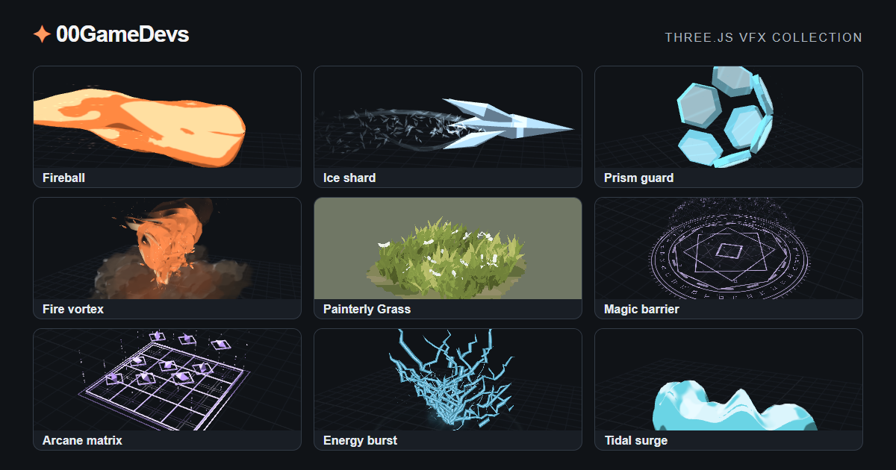

[English](README.md) · [繁體中文](README.zh-TW.md) · [简体中文](README.zh-CN.md) · [日本語](README.ja.md)

# 00GameDevs — Three.js ゲーム素材ライブラリ

VFX、3D オブジェクト、シェーダーをブラウザーでプレビューできます。素材を調整し、コードをコピーまたはダウンロードして Three.js のゲームに組み込めます。

**[ライブラリを開く（英語）→](https://00gamedevs.com/en/)** · [繁体字中国語サイト](https://00gamedevs.com/zh-TW/)

## 素材を見る

- **[VFX](https://00gamedevs.com/en/)**：飛び道具、ビーム、爆発、魔法、画面エフェクト。
- **[オブジェクト](https://00gamedevs.com/en/objects/)**：植物、小道具、ゲーム用オブジェクト。
- **[シェーダー](https://00gamedevs.com/en/shaders/)**：プレビューしながら調整できるマテリアルや描画表現のサンプル。

素材を開いてプレビューし、「Copy」または「Download」でコードを取得します。組み込み時には、プロジェクトの Three.js バージョンや描画設定に合わせた確認が必要です。最新の素材と見た目は公式サイトをご確認ください。画像は紹介用です。

## AI コーディングアシスタントで使う

アシスタントに [AI 向け入口](https://00gamedevs.com/llms.txt)と[英語の組み込みガイド](https://00gamedevs.com/ai/integration.en.md)を渡してください。[繁体字中国語のガイド](https://00gamedevs.com/ai/integration.zh-TW.md)もあります。[v2 カタログ](https://00gamedevs.com/ai/catalog.v2.json)には VFX とオブジェクト、ダウンロード先、SHA-256 チェックサムが含まれます。シェーダーはこの AI カタログの対象外です。サイト上で閲覧・エクスポートしてください。

> https://00gamedevs.com/ai/integration.en.md と https://00gamedevs.com/ai/catalog.v2.json を読み、私が変更を許可した Three.js ゲーム用の素材を選んでください。ダウンロードのチェックサムを検証し、ライセンスを保持してください。素材の組み込み方式に従い、ゲームのルールを変えずに再生とリソース解放を確認してください。

公開カタログにはアカウントや API キーは不要です。[AI ガイドへのリンクと手順](AI-GUIDE.md)もご覧ください。

## 素材のライセンス

サイトの VFX・シェーダー・オブジェクトのエクスポート機能で提供するオリジナルコードは **MIT ライセンス**です。商用利用・改変が可能です。著作権表示とライセンス文を保持してください。ゲームのクレジットへの記載は任意です。第三者の依存ライブラリについては、それぞれのライセンスも保持してください。[ライセンス全文](ASSET-LICENSE.md)をご確認ください。

このリポジトリは素材ライブラリの紹介用です。Web サイト全体のソースコードや素材のミラーではありません。素材のライセンスは、サイト UI、ブランド、アバター、紹介画像には適用されません。素材を使うためにこのリポジトリをクローンする必要はありません。

## 言語と連絡先

この紹介は英語・繁体字中国語・簡体字中国語・日本語に対応しています。公式サイトと詳細な AI 組み込みガイドは、現在英語と繁体字中国語で提供しています。

制作：**00GameDevs / [@00vchannel](https://github.com/00vchannel)**。素材へのご意見はサイト内のフィードバックボタンから送信できます。連絡先：[info@deepframestudiolimited.com](mailto:info@deepframestudiolimited.com)。
