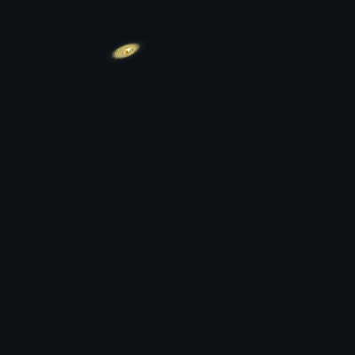
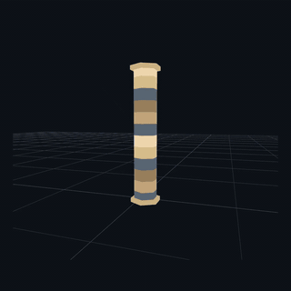

[English](README.md) · [繁體中文](README.zh-TW.md) · [简体中文](README.zh-CN.md) · [日本語](README.ja.md)

# 00GameDevs VFX Library

**Free VFX for web games. Preview it. Copy it in one click. Make it yours.**

Fire, magic, energy and impact effects for Three.js web games. Try them in your browser, adjust the look, and copy the code without signing up.

### [Explore free VFX →](https://00gamedevs.com/en/)

| Golden Chain Rain | Dimensional Rend |
|:---:|:---:|
|  |  |

## From preview to your web game

1. **Pick an effect** and watch it play in the browser.
2. **Make it yours** with the available color, size and speed controls.
3. **Click Copy** to get the effect code, or download it as a file.

Use the code in your Three.js game's scene and update loop. One click copies the code; connecting it to your game depends on your project's setup.

## Free, including commercial games

Exported original effect code is **MIT-licensed**. Use it in free or paid web games, modify it and keep your game source private. Keep the copyright and license text; an in-game credit is optional. [Full asset license](ASSET-LICENSE.md).

Want more? Browse [3D objects](https://00gamedevs.com/en/objects/) and [shaders](https://00gamedevs.com/en/shaders/) on the same website.

---

[Live library](https://00gamedevs.com/en/) · [繁體中文網站](https://00gamedevs.com/zh-TW/) · [Integration resources](AI-GUIDE.md)

By **[00vchannel](https://github.com/00vchannel)**. Feedback: use the website's feedback button or [email us](mailto:info@deepframestudiolimited.com).

*GIFs are compressed preview recordings; use the live library for current visuals and controls. This repository introduces the library and does not contain the website source. The asset license does not cover branding or preview images. The live website is available in English and Traditional Chinese.*
