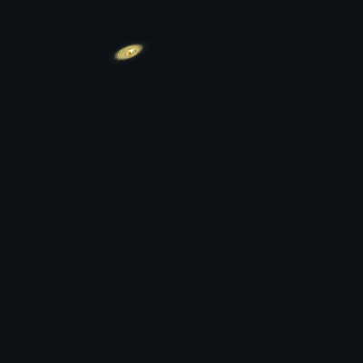
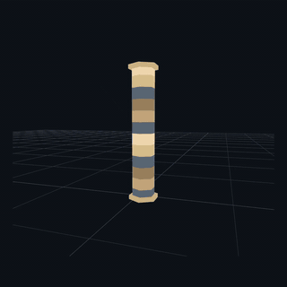
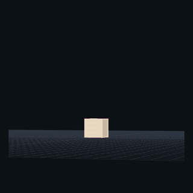
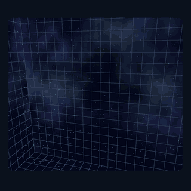

[English](README.md) · [繁體中文](README.zh-TW.md) · [简体中文](README.zh-CN.md) · [日本語](README.ja.md)

# 00GameDevs VFX Library

**免费网页游戏特效。实时预览，一键复制，自由调整。**

为 Three.js 网页游戏加入火焰、魔法、能量与命中特效。在浏览器中预览、调整外观，无需注册即可复制代码。

### [探索免费特效（英文网站）→](https://00gamedevs.com/en/)

| [金链骤雨](https://00gamedevs.com/en/effects/golden-chain-rain/) | [次元裂斩](https://00gamedevs.com/en/effects/dimensional-rend/) |
|:---:|:---:|
|  |  |

| [暗链崩阵](https://00gamedevs.com/en/effects/darkchain-detonation/) | [黑洞](https://00gamedevs.com/en/effects/black-hole/) |
|:---:|:---:|
|  |  |

## 从预览到你的网页游戏

1. **选特效**：直接在浏览器中观看动画。
2. **调外观**：使用素材提供的颜色、大小与速度选项。
3. **一键复制**：点击 Copy 获取特效代码，也可以下载文件。

将代码接入 Three.js 游戏的场景与更新流程。一键复制的是代码；接入方式仍需适配你的项目。

## 免费，也能用于商业游戏

导出的原创特效代码采用 **MIT 许可证**，可用于免费或付费网页游戏、自由修改，无需公开游戏源代码。请保留版权及许可文本，不强制在游戏制作人员名单中署名。[完整素材许可](ASSET-LICENSE.md)。

需要更多素材？同站还有 [3D 物体](https://00gamedevs.com/en/objects/)和 [Shader](https://00gamedevs.com/en/shaders/)。

---

[进入素材库（英文）](https://00gamedevs.com/en/) · [繁体中文网站](https://00gamedevs.com/zh-TW/) · [整合资源](AI-GUIDE.md)

作者：**[00vchannel](https://github.com/00vchannel)**。问题可通过网站的反馈按钮提交，或[联系我们](mailto:info@deepframestudiolimited.com)。

*GIF 为压缩展示录像，最新外观及可调选项以正式网站为准。本仓库介绍素材库，不包含网站源代码；素材许可不涵盖品牌及展示图片。正式网站提供英文与繁体中文。*
