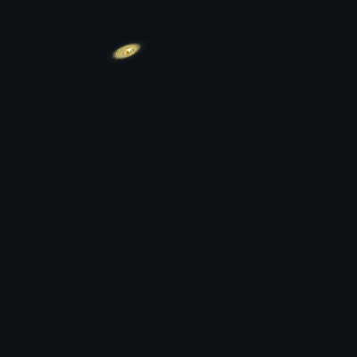
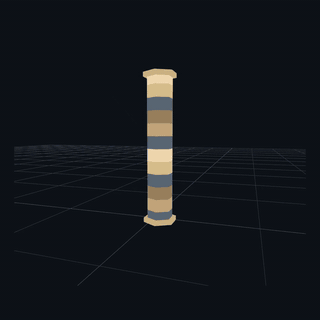
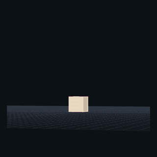
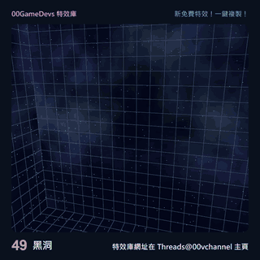

[English](README.md) · [繁體中文](README.zh-TW.md) · [简体中文](README.zh-CN.md) · [日本語](README.ja.md)

# 00GameDevs VFX Library

**免費網頁遊戲特效。即時預覽，一鍵複製，自由調整。**

為 Three.js 網頁遊戲加入火焰、魔法、能量與命中特效。在瀏覽器試看、調整外觀，免註冊就能複製程式。

### [探索免費特效 →](https://00gamedevs.com/zh-TW/)

| [金鏈驟雨](https://00gamedevs.com/zh-TW/effects/golden-chain-rain/) | [次元裂斬](https://00gamedevs.com/zh-TW/effects/dimensional-rend/) |
|:---:|:---:|
|  |  |

| [闇鏈崩陣](https://00gamedevs.com/zh-TW/effects/darkchain-detonation/) | [黑洞](https://00gamedevs.com/zh-TW/effects/black-hole/) |
|:---:|:---:|
|  |  |

## 從預覽到你的網頁遊戲

1. **選特效**：直接在瀏覽器觀看動畫。
2. **調外觀**：使用素材提供的顏色、大小與速度選項。
3. **一鍵複製**：取得特效程式，也可以下載檔案。

將程式接入 Three.js 遊戲的場景與更新流程。一鍵複製的是程式；接入方式仍需配合你的專案。

## 免費，也能用於商業遊戲

匯出的原創特效程式採 **MIT 授權**，可用於免費或付費網頁遊戲、自由修改，不需要公開遊戲原始碼。保留版權與授權文字即可，不強制在遊戲工作人員名單署名。[完整素材授權](ASSET-LICENSE.md)。

需要更多素材？同站也有 [3D 物件](https://00gamedevs.com/zh-TW/objects/)與 [Shader](https://00gamedevs.com/zh-TW/shaders/)。

---

[進入素材庫](https://00gamedevs.com/zh-TW/) · [English website](https://00gamedevs.com/en/) · [整合資源](AI-GUIDE.md)

作者：**[00vchannel](https://github.com/00vchannel)**。問題可使用網站回報按鈕，或[寄信給我們](mailto:info@deepframestudiolimited.com)。

*GIF 為壓縮展示錄影，最新外觀與可調選項以正式網站為準。本專案介紹素材庫，不包含網站原始碼；素材授權不涵蓋品牌及展示圖。正式網站提供英文與繁體中文。*
