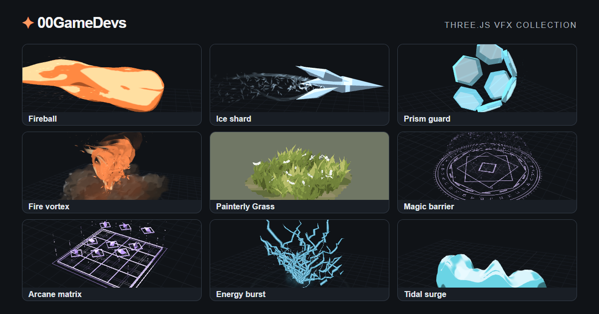

[English](README.md) · [繁體中文](README.zh-TW.md) · [简体中文](README.zh-CN.md) · [日本語](README.ja.md)

# 00GameDevs — Three.js 遊戲素材庫

在瀏覽器預覽 VFX、3D 物件與 Shader。調整喜歡的素材，再複製或下載程式，接入你的 Three.js 遊戲。

**[進入素材庫 →](https://00gamedevs.com/zh-TW/)** · [English website](https://00gamedevs.com/en/)

## 瀏覽素材

- **[特效](https://00gamedevs.com/zh-TW/)**：投射物、光束、爆炸、魔法與畫面效果。
- **[物件](https://00gamedevs.com/zh-TW/objects/)**：植被、道具及遊戲物件。
- **[Shader](https://00gamedevs.com/zh-TW/shaders/)**：可預覽與調整的材質及畫面呈現範例。

打開素材、預覽，再按「複製」或「下載」即可取得程式。實際接入仍需配合專案的 Three.js 版本與繪製設定。素材與外觀以正式網站為準，圖片僅作展示。

## 讓 AI 程式助手協助接入

將 [AI 入口](https://00gamedevs.com/llms.txt)與[繁中整合指南](https://00gamedevs.com/ai/integration.zh-TW.md)交給助手。[v2 目錄](https://00gamedevs.com/ai/catalog.v2.json)包含 VFX、物件、下載連結及 SHA-256 校驗值；Shader 透過網站瀏覽與匯出，不在這份 AI 目錄內。

> 請閱讀 https://00gamedevs.com/ai/integration.zh-TW.md 與 https://00gamedevs.com/ai/catalog.v2.json，為我授權的 Three.js 遊戲選材。核對下載校驗值、保留授權，依素材的接入類型整合，驗證播放與清理，不改動遊戲規則。

公開目錄不需要帳號或 API key。詳見 [AI 指南入口與流程](AI-GUIDE.md)。

## 素材授權

網站 VFX、Shader 與物件匯出功能交付的原創程式採 **MIT 授權**，可免費商用及修改。請保留版權與授權文字，不強制在工作人員名單署名；第三方依賴仍須保留各自授權。詳見[完整素材授權](ASSET-LICENSE.md)。

這個專案是素材庫介紹，不包含整個網站原始碼，也不是素材鏡像站。素材授權不涵蓋網站介面、品牌、頭像與宣傳圖片。使用素材不需要下載這個 GitHub 專案。

## 語言與聯絡

介紹提供英文、繁中、簡中及日文；正式網站與完整 AI 整合指南目前提供英文及繁中。

作者：**00GameDevs / [@00vchannel](https://github.com/00vchannel)**。素材問題可使用網站的回報按鈕；聯絡信箱：[info@deepframestudiolimited.com](mailto:info@deepframestudiolimited.com)。
